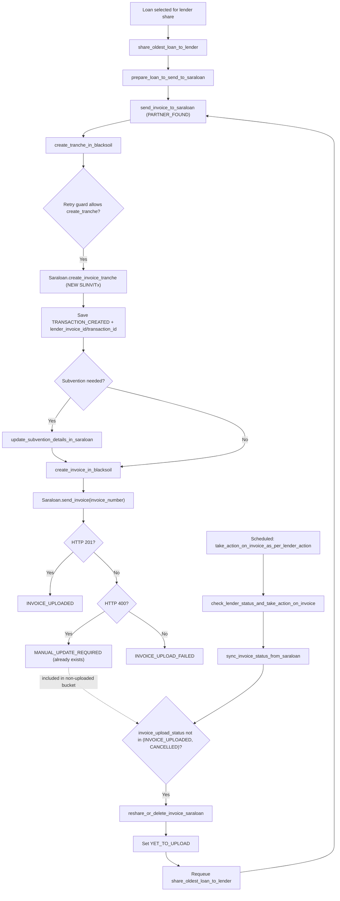
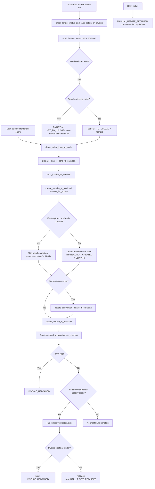

# Lender Invoice Share Flow (SLINV Churn) - Current vs Proposed

This document captures the current and proposed flow for lender invoice sharing, focused on the SLINV churn issue (same loan/invoice getting multiple tranche IDs over retries).

Related Jira issues:
- `LOC-28` (parent bug)
- `LOC-29` idempotent tranche guard + lock
- `LOC-30` prevent `YET_TO_UPLOAD` reset when tranche exists
- `LOC-31` duplicate-400 recovery via lender verification
- `LOC-32` stop `MANUAL_UPDATE_REQUIRED` auto-retry loop
- `LOC-33` tighten action-job eligibility + state-authority matrix

---

## Current Flow

### Current behavior summary
- `MANUAL_UPDATE_REQUIRED` can re-enter periodic reset/re-share flow.
- `create_tranche_in_blacksoil` can create a new tranche on re-entry.
- Same LLM can get reassigned from one `SLINV` to another over time.

---

## Proposed Flow

### Proposed behavior summary
- Once tranche exists, it is reused (no SLINV churn).
- Duplicate-400 is handled as recoverable with lender verification.
- `MANUAL_UPDATE_REQUIRED` no longer loops automatically.

---

## Ticket to Flow Mapping

- `LOC-29`: `create_tranche_in_blacksoil` idempotency + lock (`E`, `E0`, `Eskip`, `Ecreate`)
- `LOC-30`: prevent `YET_TO_UPLOAD` reset for already-tranched rows (`S`, `T`, `T1`)
- `LOC-31`: duplicate-400 recovery (`H4`, `H5`, `H6`, `H7`)
- `LOC-32`: stop `MANUAL_UPDATE_REQUIRED` auto-retry (`M1`)
- `LOC-33`: tighten action-job eligibility and status authority (`P`, `Q`, `R`, `S`)

---

## Example Incident (Reference)

For `LenderLoanMap` `id=392216` (loan `1901771`, invoice `2026$$TI20261001001450`), historical transitions showed multiple tranche IDs over time:
- `SLINV658114`
- `SLINV658170`
- `SLINV658301`

With repeated duplicate error: `already exists`.

This is the concrete scenario the proposed flow is designed to prevent.
