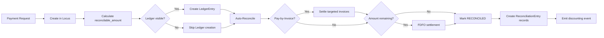
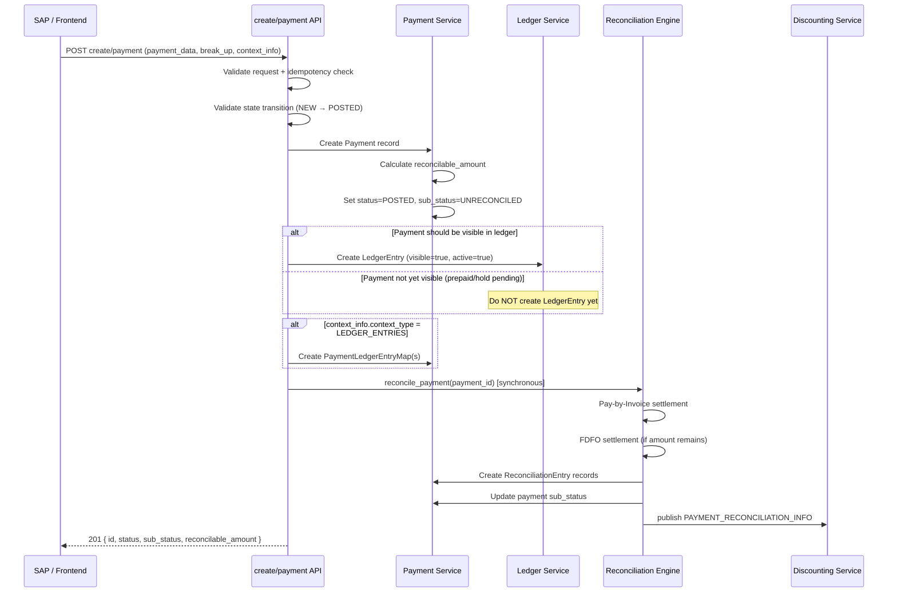
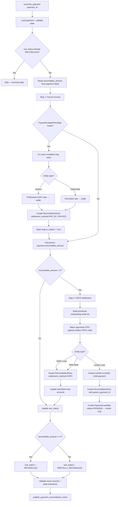
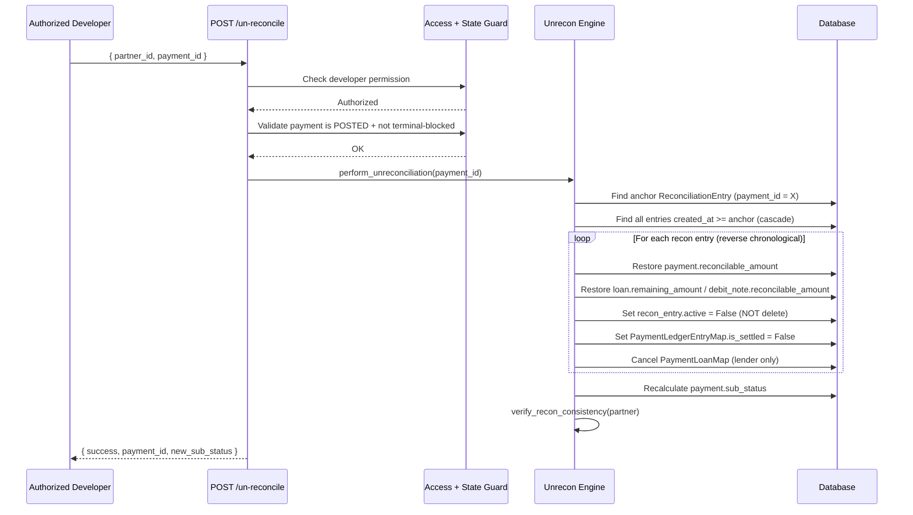
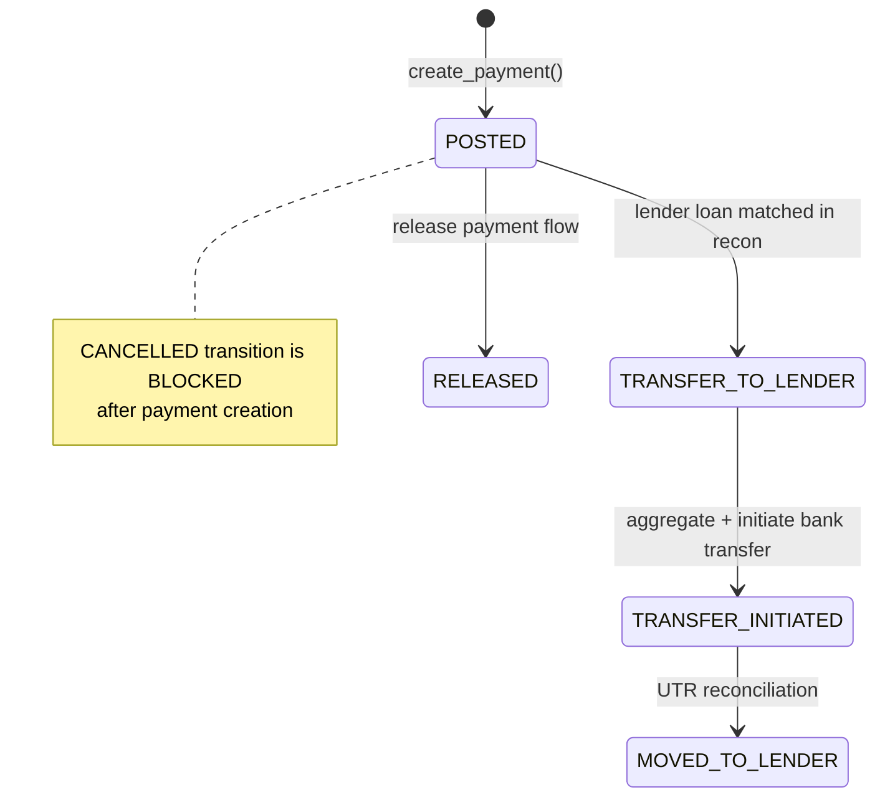
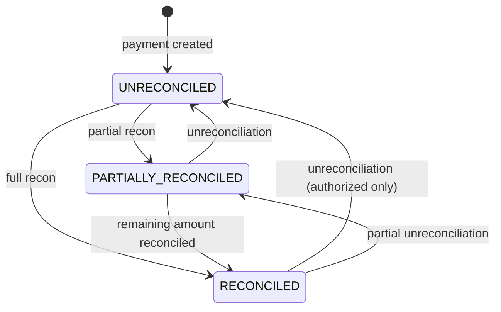

# Payment Flow — Design Specification

> **Status:** Requirements & target design document  
> **Scope:** Payment creation, reconciliation, and unreconciliation in Locus + Ledger  
> **Note:** No system changes have been made. This document captures target behavior, data flows, state machines, and pseudocode against current codebase context.

---

## Table of Contents

1. [Overview](#1-overview)
2. [Key Entities](#2-key-entities)
3. [Payment Creation Flow](#3-payment-creation-flow)
4. [Reconciliation Logic](#4-reconciliation-logic)
5. [Unreconciliation Logic](#5-unreconciliation-logic)
6. [State Machines](#6-state-machines)
7. [Terminal State Protection](#7-terminal-state-protection)
8. [Current vs Target Gaps](#8-current-vs-target-gaps)
9. [Appendix: Key File References](#9-appendix-key-file-references)

---

## 1. Overview

The payment lifecycle spans two systems:

| System | Responsibility | Primary Model |
|--------|----------------|---------------|
| **Ledger** | Customer-facing accounting entries (SAP sync) | `LedgerEntry` |
| **Locus (Payment)** | Reconciliation, loan settlement, lender transfer | `Payment` |

Today these are created via **separate API calls** with no atomic link. The target design unifies behavior around clear state transitions, creation-time reconciliation, and immutable terminal states.

### High-Level Lifecycle



---

## 2. Key Entities

### 2.1 Payment (`payment.model.Payment`)

| Field | Purpose |
|-------|---------|
| `status` | Lifecycle state: `DRAFT`, `POSTED`, `CANCELLED`, `TRANSFER_TO_LENDER`, etc. |
| `sub_status` | Reconciliation state: `UNRECONCILED`, `PARTIALLY_RECONCILED`, `RECONCILED` |
| `payment_amount` | Total payment value |
| `reconcilable_amount` | Amount available for reconciliation |
| `hold_amount` | Amount reserved for prepaid/hold orders |
| `aecl_amount` | Advance exceeding credit limit (informational) |
| `transfer_to_lender_amount` | Amount allocated to lender transfer |
| `parent_payment_id` | Reference to source payment (for transfer-to-lender children) |

### 2.2 ReconciliationEntry (`loan.model.ReconciliationEntry`)

Immutable audit record linking a payment to an outstanding entity (loan, debit note, lender loan).

| Field | Purpose |
|-------|---------|
| `payment_id` | Payment that was reconciled |
| `parent_payment_id` | **(Target)** Source payment for transfer-to-lender recon entries |
| `outstanding_entity_id` | Loan / debit note / lender loan ID |
| `outstanding_entity_type` | `GAPL_LOAN`, `DEBIT_NOTE`, `LENDER_LOAN` |
| `payment_amount_used` | Amount applied in this recon entry |
| `active` | **(Target)** Soft-delete flag instead of hard delete on unrecon |
| `settlement_method` | **(Target)** `PAY_BY_INVOICE` or `FDFO` |

### 2.3 PaymentLedgerEntryMap (`payment.model.PaymentLedgerEntryMap`)

Maps a payment to specific ledger entries for pay-by-invoice settlement.

| Field | Purpose |
|-------|---------|
| `payment` | FK to Payment |
| `ledger_entry` | FK to LedgerEntry |
| `is_settled` | Whether pay-by-invoice settlement completed |

### 2.4 PaymentLoanMap (`loan.model.PaymentLoanMap`)

Links payment to loan after reconciliation. **Target:** only created for lender-payment recon, not for non-lender GAPL recon.

### 2.5 LedgerEntry (`ledger.model.LedgerEntry`)

| Field | Purpose |
|-------|---------|
| `active` | Entry is live (not cancelled) |
| `visible` | Entry appears in customer ledger view |

**Target:** No deferred visibility logic. Ledger entry is created only when the payment is intended to be visible.

---

## 3. Payment Creation Flow

### 3.1 Entry Point

```
POST /payment/payments          → Locus Payment record
POST /ledger/payment/create     → Ledger LedgerEntry record
```

**Target:** A single orchestrated `create/payment` flow that handles both systems atomically.

### 3.2 Data Flow



### 3.3 Pseudocode: Payment Creation

```python
@transaction.atomic
def create_payment(request_data: dict) -> Payment:
    # ── 1. Validate ──────────────────────────────────────────
    validate_create_payment_request(request_data)
    customer_credit_line = resolve_credit_line(request_data)

    # Idempotency: (customer_credit_line, lender_payment_ref_number, lender_payment_id)
    existing = find_existing_payment(customer_credit_line, request_data)
    if existing:
        return existing

    # ── 2. Build payment payload ───────────────────────────────
    payment_data = populate_payment(customer_credit_line, request_data)
    apply_break_up(payment_data, request_data.get("break_up", {}))

    # ── 3. State transition: NEW → POSTED ─────────────────────
    assert_valid_transition(current=None, target=PaymentStatus.POSTED)
    payment_data["status"] = PaymentStatus.POSTED
    payment_data["sub_status"] = PaymentSubStatus.UNRECONCILED

    # ── 4. Calculate reconcilable_amount at creation ─────────
    payment_data["reconcilable_amount"] = calculate_reconcilable_amount(
        payment_amount=payment_data["payment_amount"],
        hold_amount=payment_data.get("hold_amount", 0),
        refund_amount=payment_data.get("refund_amount", 0),
        transfer_to_lender_amount=0,  # always 0 at creation
    )

    # ── 5. Persist payment ─────────────────────────────────────
    payment = Payment.objects.create(**payment_data)

    # ── 6. Pay-by-invoice mapping ──────────────────────────────
    context_info = request_data.get("context_info", {})
    if context_info.get("context_type") == "LEDGER_ENTRIES":
        for ledger_id in parse_ledger_ids(context_info["context_id"]):
            PaymentLedgerEntryMap.objects.create(
                payment=payment,
                ledger_entry_id=ledger_id,
                partner_id=customer_credit_line.customer.source_identifier_id,
                is_settled=False,
            )

    # ── 7. Ledger entry (only if visible) ──────────────────────
    if should_create_visible_ledger_entry(payment, request_data):
        create_ledger_entry(
            payment=payment,
            visible=True,
            active=True,
            # No deferred visibility_blocked_type logic
        )
    # else: do NOT create ledger entry; create later when visibility is intended

    # ── 8. Auto-reconcile synchronously ────────────────────────
    reconcile_payment(payment.id)

    return payment


def calculate_reconcilable_amount(
    payment_amount, hold_amount, refund_amount, transfer_to_lender_amount
) -> Decimal:
    """
    Target formula (consistent at creation AND reconciliation):
        reconcilable_amount = payment_amount - hold_amount - refund_amount - transfer_to_lender_amount
    """
    return payment_amount - hold_amount - (refund_amount or 0) - (transfer_to_lender_amount or 0)


def should_create_visible_ledger_entry(payment, request_data) -> bool:
    """
    Target: Ledger entry created ONLY when payment is intended to be visible.
    No active/visible flip-flop based on debit hold arrival.
    """
    if payment.hold_amount > 0 and not debit_hold_exists(request_data):
        return False  # prepaid — wait for debit hold, don't create ledger entry
    if is_release_payment_pending_invoice(request_data):
        return False  # release payment waiting for invoice
    return True
```

### 3.4 Creation Rules

| Rule | Target Behavior |
|------|-----------------|
| `reconcilable_amount` | Calculated at creation, not deferred to reconciliation |
| Idempotency | Return existing payment on duplicate `(credit_line, ref_number, payment_id)` |
| Cancellation after creation | **Not allowed** — invalid state transition |
| Ledger visibility | Create ledger entry only when visible; no `visibility_blocked_type` deferred logic |
| GAPL vs Lender | GAPL payments get `reconcilable_amount > 0`; lender payments get `0` |
| `aecl_amount` | Stored for reporting; does not reduce `reconcilable_amount` |

### 3.5 Invalid Operations at Creation

```python
# Payments cannot be cancelled after creation
INVALID_TRANSITIONS = {
    (PaymentStatus.POSTED, PaymentStatus.CANCELLED),  # blocked
    (PaymentStatus.RECONCILED, *),                     # terminal — any mutation blocked
}

def assert_payment_not_in_terminal_state(payment):
    if payment.sub_status == PaymentSubStatus.RECONCILED:
        report_to_dev_team(
            event="TERMINAL_STATE_MUTATION_ATTEMPT",
            payment_id=payment.id,
            fields_attempted=["status", "sub_status", "reconcilable_amount",
                              "payment_amount", "hold_amount", "aecl_amount"],
        )
        raise TerminalStateError("Cannot modify reconciled payment fields")
```

---

## 4. Reconciliation Logic

### 4.1 Principles

| Principle | Target |
|-----------|--------|
| Timing | Reconcile **synchronously at payment creation** |
| Retry task | Celery task only for **failed / unreconciled** payments |
| Settlement order | Pay-by-Invoice first → FDFO for remaining amount |
| Recon entries | Immutable once created; soft-deactivate on unrecon |
| Discounting event | Emit **only after** reconciliation completes |
| PaymentLoanMap | Created **only** for lender-payment reconciliation |

### 4.2 Reconciliation Data Flow



### 4.3 Pseudocode: Main Reconciliation

```python
@transaction.atomic
def reconcile_payment(payment_id: int) -> ReconciliationResult:
    payment = Payment.objects.select_for_update().get(id=payment_id)

    # Guard: terminal state
    if payment.sub_status == PaymentSubStatus.RECONCILED:
        return ReconciliationResult(skipped=True, reason="already_reconciled")

    assert payment.status == PaymentStatus.POSTED
    assert payment.customer_credit_line.credit_product.belongs_to_gapl

    partner_id = payment.customer_credit_line.customer.source_identifier_id

    # Recalculate reconcilable_amount (should match creation-time value)
    payment.reconcilable_amount = calculate_reconcilable_amount(
        payment.payment_amount, payment.hold_amount,
        payment.refund_amount, payment.transfer_to_lender_amount,
    )
    payment.save(update_fields=["reconcilable_amount"])

    recon_entries_created = []

    # ── Step 1: Pay-by-Invoice ─────────────────────────────────
    ledger_maps = PaymentLedgerEntryMap.objects.filter(
        payment=payment, is_settled=False, active=True,
    )
    for map_entry in ledger_maps:
        entry = reconcile_pay_by_invoice(map_entry, payment)
        if entry:
            entry.settlement_method = SettlementMethod.PAY_BY_INVOICE
            recon_entries_created.append(entry)
            map_entry.is_settled = True
            map_entry.save()

    # ── Step 2: FDFO (only if amount remains) ────────────────────
    if payment.reconcilable_amount > 0:
        outstanding_entities = build_fdfo_entity_list(partner_id)
        fdfo_entries = reconcile_fdfo(payment, outstanding_entities)
        for entry in fdfo_entries:
            entry.settlement_method = SettlementMethod.FDFO
        recon_entries_created.extend(fdfo_entries)

    # ── Step 3: Update payment sub_status ────────────────────────
    update_payment_sub_status(payment)

    # ── Step 4: Validate ─────────────────────────────────────────
    validate_recon_records(payment, recon_entries_created)
    assert_valid_transition(
        payment.sub_status,
        payment.sub_status,  # post-recon sub_status
    )

    # ── Step 5: Discounting event (only after recon completes) ─────
    if payment.sub_status in (PaymentSubStatus.RECONCILED, PaymentSubStatus.PARTIALLY_RECONCILED):
        recon_info = build_recon_info_for_payment(payment)
        publish_payment_reconciliation_event(payment.id, recon_info)

    return ReconciliationResult(entries=recon_entries_created)


def reconcile_pay_by_invoice(map_entry, payment) -> ReconciliationEntry | None:
    ledger_entry = map_entry.ledger_entry
    amount_to_settle = min(payment.reconcilable_amount, ledger_entry.remaining_amount)

    if amount_to_settle <= 0:
        return None

    if ledger_entry.type == "INVOICE":
        loan = find_or_create_gapl_loan(ledger_entry)
        return settle_against_loan(payment, loan, amount_to_settle)
    elif ledger_entry.type in ("DEBIT_NOTE", "DEBIT_ENTRY"):
        debit_note = find_debit_note(ledger_entry.erp_id)
        return settle_against_debit_note(payment, debit_note, amount_to_settle)

    return None


def reconcile_fdfo(payment, outstanding_entities) -> list[ReconciliationEntry]:
    """
    FDFO = First Due First Out.
    Entities sorted by effective overdue date within priority buckets:
      1. Top-priority debit notes
      2. Debit holds
      3. Aged GAPL loans / debit notes
      4. Lender loans in overdue state
      5. Remaining outstanding entities
    Payments sorted FIFO by payment_date.
    """
    entries = []
    remaining = payment.reconcilable_amount

    for entity in outstanding_entities:
        if remaining <= 0:
            break

        entity_reconcilable = get_entity_reconcilable_amount(entity)
        settle_amount = min(remaining, entity_reconcilable)

        if entity.type == OutstandingEntityTypes.GAPL_LOAN:
            entry = settle_against_loan(payment, entity, settle_amount)
            # NO PaymentLoanMap for non-lender GAPL recon

        elif entity.type == OutstandingEntityTypes.DEBIT_NOTE:
            entry = settle_against_debit_note(payment, entity, settle_amount)

        elif entity.type == OutstandingEntityTypes.LENDER_LOAN:
            child_payment = create_transfer_to_lender_payment(
                parent=payment, amount=settle_amount,
            )
            entry = ReconciliationEntry.objects.create(
                partner_id=payment.partner_id,
                payment_id=child_payment.id,
                parent_payment_id=payment.id,          # NEW: parent reference
                outstanding_entity_id=entity.id,
                outstanding_entity_type=OutstandingEntityTypes.LENDER_LOAN,
                payment_amount_used=settle_amount,
                settlement_method=SettlementMethod.FDFO,
                active=True,
            )
            PaymentLoanMap.objects.create(             # lender recon ONLY
                payment=child_payment,
                payment_amount_used=settle_amount,
                status=PaymentLoanMapStatus.PENDING,
            )
            payment.transfer_to_lender_amount += settle_amount

        entries.append(entry)
        remaining -= settle_amount
        payment.reconcilable_amount = remaining

    payment.save()
    return entries
```

### 4.4 FDFO Entity Priority (Current Implementation Reference)

```
Priority order (high → low):
  1. top_priority_debit_notes
  2. debit_holds
  3. aged_entities (GAPL loans + debit notes past cutoff)
  4. lender_loans_in_overdue_state
  5. outstanding_entities (remaining GAPL loans + debit notes)

Within each bucket: sort by custom_sort_order (effective overdue date)
Payments: order_by("payment_date", "created_at", "id")
```

### 4.5 Transfer-to-Lender Payment

```python
def create_transfer_to_lender_payment(parent: Payment, amount: Decimal) -> Payment:
    child = Payment(
        customer_credit_line=parent.customer_credit_line,
        status=PaymentStatus.TRANSFER_TO_LENDER,
        sub_status=PaymentSubStatus.UNRECONCILED,
        payment_amount=amount,
        reconcilable_amount=0,
        parent_payment_id=parent.id,           # parent reference on Payment
        lender_payment_ref_number=parent.lender_payment_ref_number,
        payment_date=parent.payment_date,
    )
    child.save()
    return child
```

**Target addition:** `ReconciliationEntry.parent_payment_id` so recon audit trail shows which source payment funded the lender transfer.

### 4.6 Failed Reconciliation Retry Task

```python
# Celery beat — runs periodically, NOT on every payment creation
@shared_task(queue="reconciliation")
def reconcile_failed_payments():
    """
    Only for payments that failed reconciliation at creation time.
    Normal path: reconcile synchronously during create_payment().
    """
    failed_payments = Payment.objects.filter(
        status=PaymentStatus.POSTED,
        sub_status=PaymentSubStatus.UNRECONCILED,
        reconcilable_amount__gt=0,
        reconciliation_failed=True,       # NEW flag
        customer_credit_line__credit_product__belongs_to_gapl=True,
    )
    for payment in failed_payments:
        try:
            reconcile_payment(payment.id)
            payment.reconciliation_failed = False
            payment.save()
        except Exception as e:
            log_reconciliation_failure(payment.id, e)
            # retry with backoff via Celery
```

### 4.7 ReconciliationEntry Immutability

```python
class ReconciliationEntry(BaseModel):
    # ... existing fields ...
    parent_payment_id = models.PositiveBigIntegerField(null=True)   # NEW
    settlement_method = models.CharField(choices=SettlementMethod.choices)  # NEW
    active = models.BooleanField(default=True)                      # use for soft-delete

    def save(self, *args, **kwargs):
        if not self._state.adding:
            raise ImmutableRecordError("ReconciliationEntry cannot be modified after creation")
        super().save(*args, **kwargs)

    def deactivate(self):
        """Called during unreconciliation — soft delete, not hard delete."""
        self.active = False
        self.save(update_fields=["active"])  # requires immutability exception for active field
```

---

## 5. Unreconciliation Logic

### 5.1 Principles

| Principle | Target |
|-----------|--------|
| Access control | Restricted to authorized developers/ops only |
| Recon entry deletion | **Soft-deactivate** (`active=False`), never hard delete |
| Discounting reversal | Not required — discounting service is recon/unrecon agnostic |
| Data sanity | Cascade unrecon in chronological order; validate amounts after |
| Audit trail | Full history preserved via inactive recon entries |

### 5.2 Unreconciliation Data Flow



### 5.3 Pseudocode: Unreconciliation

```python
# Permission: only specific developer roles
UNRECON_ALLOWED_ROLES = ["LOCUS_ADMIN", "PAYMENT_OPS_LEAD"]

def perform_unreconciliation(payment_id: int, requester: User) -> bool:
    assert requester.has_any_role(UNRECON_ALLOWED_ROLES), "Unauthorized"

    payment = Payment.objects.get(id=payment_id)
    partner_id = payment.customer_credit_line.customer.source_identifier_id

    # Guards
    if is_reconciliation_restricted(partner_id):
        raise ReconciliationRestrictedError(partner_id)
    if payment.status != PaymentStatus.POSTED:
        raise InvalidStateError(f"Cannot unrecon payment in status {payment.status}")
    if payment.sub_status == PaymentSubStatus.UNRECONCILED:
        return True  # already unreconciled

    with redis_recon_lock(partner_id):
        # Find anchor entry for this payment
        anchor_entries = ReconciliationEntry.objects.filter(
            payment_id=payment.id,
            active=True,
        ).order_by("created_at")

        if not anchor_entries.exists():
            return True

        anchor_timestamp = anchor_entries.first().created_at

        # Cascade: unrecon ALL entries for partner created at or after anchor
        entries_to_unrecon = ReconciliationEntry.objects.filter(
            partner_id=partner_id,
            active=True,
            created_at__gte=anchor_timestamp,
        ).order_by("-created_at")  # reverse chronological

        unreconcile_entries(entries_to_unrecon)
        verify_recon_consistency(payment.customer_credit_line)

    return True


def unreconcile_entries(entries: QuerySet):
    for entry in entries:
        payment = Payment.objects.get(id=entry.payment_id)
        amount = entry.payment_amount_used

        # Restore payment
        payment.reconcilable_amount += amount
        if entry.outstanding_entity_type == OutstandingEntityTypes.LENDER_LOAN:
            payment.transfer_to_lender_amount -= amount

        # Restore outstanding entity
        restore_outstanding_entity(entry)

        # Soft-deactivate recon entry (NOT hard delete)
        entry.active = False
        entry.save(update_fields=["active"])

        # Reset pay-by-invoice map
        PaymentLedgerEntryMap.objects.filter(
            payment=payment, is_settled=True,
        ).update(is_settled=False)

        # Cancel lender PaymentLoanMap
        if entry.outstanding_entity_type == OutstandingEntityTypes.LENDER_LOAN:
            PaymentLoanMap.objects.filter(
                payment_id=entry.payment_id, status="PENDING",
            ).update(status="CANCELLED")

    # Update payment sub_status
    update_payment_sub_status_after_unrecon(payment)


def update_payment_sub_status_after_unrecon(payment):
    max_reconcilable = calculate_reconcilable_amount(
        payment.payment_amount, payment.hold_amount,
        payment.refund_amount, payment.transfer_to_lender_amount,
    )
    if payment.reconcilable_amount == max_reconcilable:
        payment.sub_status = PaymentSubStatus.UNRECONCILED
    elif payment.reconcilable_amount > 0:
        payment.sub_status = PaymentSubStatus.PARTIALLY_RECONCILED
    else:
        raise DataSanityError("reconcilable_amount exceeds maximum after unrecon")
    payment.save()
```

### 5.4 Unreconciliation Access Control

```python
class UnReconcilePaymentAPIView(APIView):
    permission_classes = (IsAuthenticated, LocusAdminPermission)  # Target: restricted

    def post(self, request):
        # Target: remove broad IsAuthenticated / farmer permissions
        payment_id = request.data["payment_id"]
        partner_id = request.data["partner_id"]
        perform_unreconciliation(payment_id, requester=request.user)
        return Response({"status": "success"})
```

### 5.5 Data Sanity Checks

```python
def verify_recon_consistency(credit_line) -> bool:
    """
    After unrecon, verify:
      aggregated_outstanding == sum(loan.remaining_amount) + sum(debit_note.reconcilable_amount)
      payment.reconcilable_amount <= calculate_reconcilable_amount(...)
      no orphaned active ReconciliationEntry records
    """
    gapl_os = compute_aggregated_outstanding(credit_line)
    recon_derived_os = compute_os_from_active_recon_entries(credit_line)
    assert abs(gapl_os - recon_derived_os) <= 1, "Recon consistency check failed"
```

---

## 6. State Machines

### 6.1 Payment Status (`status`)



**Allowed transitions:**

| From | To | Trigger |
|------|----|---------|
| `NEW` | `POSTED` | Payment creation |
| `POSTED` | `TRANSFER_TO_LENDER` | Lender loan matched during recon |
| `TRANSFER_TO_LENDER` | `TRANSFER_INITIATED` | Aggregation cron |
| `TRANSFER_INITIATED` | `MOVED_TO_LENDER` | UTR reconciliation |
| `POSTED` | `RELEASED` | Release payment flow |

**Blocked transitions:**

| From | To | Reason |
|------|----|--------|
| `POSTED` | `CANCELLED` | Payments cannot be cancelled after creation |
| `RECONCILED` (sub_status) | any field mutation | Terminal state protection |

### 6.2 Payment Sub-Status (`sub_status`)



### 6.3 State Transition Guard

```python
PAYMENT_STATUS_TRANSITIONS = {
    None: {PaymentStatus.POSTED},
    PaymentStatus.POSTED: {
        PaymentStatus.TRANSFER_TO_LENDER,
        PaymentStatus.RELEASED,
        # PaymentStatus.CANCELLED — REMOVED
    },
    PaymentStatus.TRANSFER_TO_LENDER: {PaymentStatus.TRANSFER_INITIATED},
    PaymentStatus.TRANSFER_INITIATED: {PaymentStatus.MOVED_TO_LENDER},
}

PAYMENT_SUB_STATUS_TRANSITIONS = {
    PaymentSubStatus.UNRECONCILED: {
        PaymentSubStatus.PARTIALLY_RECONCILED,
        PaymentSubStatus.RECONCILED,
    },
    PaymentSubStatus.PARTIALLY_RECONCILED: {
        PaymentSubStatus.RECONCILED,
        PaymentSubStatus.UNRECONCILED,  # via unrecon
    },
    PaymentSubStatus.RECONCILED: {
        PaymentSubStatus.PARTIALLY_RECONCILED,  # via unrecon
        PaymentSubStatus.UNRECONCILED,          # via unrecon
    },
}

def assert_valid_transition(current, target, transition_map):
    allowed = transition_map.get(current, set())
    if target not in allowed:
        raise InvalidStateTransitionError(f"{current} → {target} not allowed")
```

---

## 7. Terminal State Protection

Once `sub_status = RECONCILED`, the following fields are **immutable**. Any mutation attempt should be blocked and reported to the dev team.

| Protected Field | Reason |
|-----------------|--------|
| `status` | Lifecycle locked after full reconciliation |
| `sub_status` | Reconciliation complete |
| `reconcilable_amount` | Fully allocated |
| `payment_amount` | Financial integrity |
| `hold_amount` | Break-up integrity |
| `aecl_amount` | Break-up integrity |

```python
TERMINAL_PROTECTED_FIELDS = [
    "status", "sub_status", "reconcilable_amount",
    "payment_amount", "hold_amount", "aecl_amount",
]

def save_payment(payment, update_fields=None):
    if payment.sub_status == PaymentSubStatus.RECONCILED:
        if update_fields and any(f in TERMINAL_PROTECTED_FIELDS for f in update_fields):
            notify_dev_team(TerminalStateMutationAlert(payment.id, update_fields))
            raise TerminalStateError(
                f"Cannot modify {update_fields} on reconciled payment {payment.id}"
            )
    payment.save(update_fields=update_fields)
```

**Exception:** Authorized unreconciliation is the only path to mutate a reconciled payment's `sub_status` and `reconcilable_amount`.

---

## 8. Current vs Target Gaps

### 8.1 Payment Creation

| Area | Current | Target |
|------|---------|--------|
| `reconcilable_amount` timing | Partially at `Payment.save()`, reset at recon start | Calculated once at creation |
| `reconcilable_amount` formula | `payment_amount - hold_amount` (inconsistent across paths) | `payment_amount - hold_amount - refund_amount - transfer_to_lender_amount` |
| Ledger visibility | Complex `active`/`visible`/`visibility_blocked_type` flip-flop | Create ledger entry only when visible |
| Dual API calls | Separate `ledger/payment/create` + `payment/payments` | Single orchestrated `create/payment` |
| Cancellation | `PATCH /payment/payment/cancel` exists | Blocked after creation |
| State transitions | No explicit FSM guards | `assert_valid_transition()` on all mutations |
| Terminal state protection | None | Block + dev team alert |

### 8.2 Reconciliation

| Area | Current | Target |
|------|---------|--------|
| Timing | Async Celery task on creation + daily cron | Synchronous at creation; Celery only for failures |
| Pay-by-Invoice → FDFO | Implemented (correct order) | Same, with explicit `settlement_method` on entries |
| Recon entry deletion | Hard delete on unrecon | Soft-deactivate (`active=False`) |
| `parent_payment_id` on recon entry | Missing for transfer-to-lender entries | Added |
| PaymentLoanMap | Created for all loan recon | Only for lender-payment recon |
| Discounting event | Published during async recon loop | Only after recon completes |
| State transition checks | None | Validate after recon |

### 8.3 Unreconciliation

| Area | Current | Target |
|------|---------|--------|
| Access control | Broad (`IsAuthenticated` OR-chain) | Restricted to admin/ops roles |
| Recon entry handling | Hard delete | Soft-deactivate |
| Discounting event on unrecon | Published from API only | Not required (service is agnostic) |
| Ledger map reset | Inconsistent across paths | Always reset `is_settled=False` |
| `perform_unreconciliation_payment` bug | Filters by `outstanding_entity_id` instead of `payment_id` | Fix filter |
| Audit trail | Lost on hard delete | Preserved via `active=False` |

---

## 9. Appendix: Key File References

| Concern | File |
|---------|------|
| Payment creation view | `payment/views.py` — `PaymentViewSet.post()` |
| Payment model + save hook | `payment/model/payment.py` |
| Payment utils (cancel, TTL) | `payment/utils.py` |
| Payment constants | `payment/constants.py` |
| Ledger payment create | `ledger/views.py` — `PaymentCreateView` |
| Ledger visibility utils | `ledger/utils.py` |
| Core reconciliation engine | `loan/utility.py` — `run_reconciliation_for_customer()` |
| Pay-by-invoice settlement | `loan/utility.py` — `settle_payment_ledger_entry_map_for_partner()` |
| Reconciliation entry model | `loan/model/reconciliation_entry.py` |
| Payment loan map model | `loan/model/payment_loan_map.py` |
| Unreconciliation API | `payment/views.py` — `UnReconcilePaymentAPIView` |
| Unreconciliation logic | `payment/utils.py` — `unreconcile_recon_entries()`, `perform_unreconciliation_payment()` |
| Batch partner unrecon | `loan/utility.py` — `run_unreconciliation_for_customer()` |
| Discounting events | `payment/tasks.py` — `publish_payment_reconciliation_event()` |
| Reconciliation tasks | `loan/tasks.py` — `run_reconciliation_for_customer_main()` |

---

*Document generated from requirements analysis against the Locus codebase. No code changes have been applied.*
