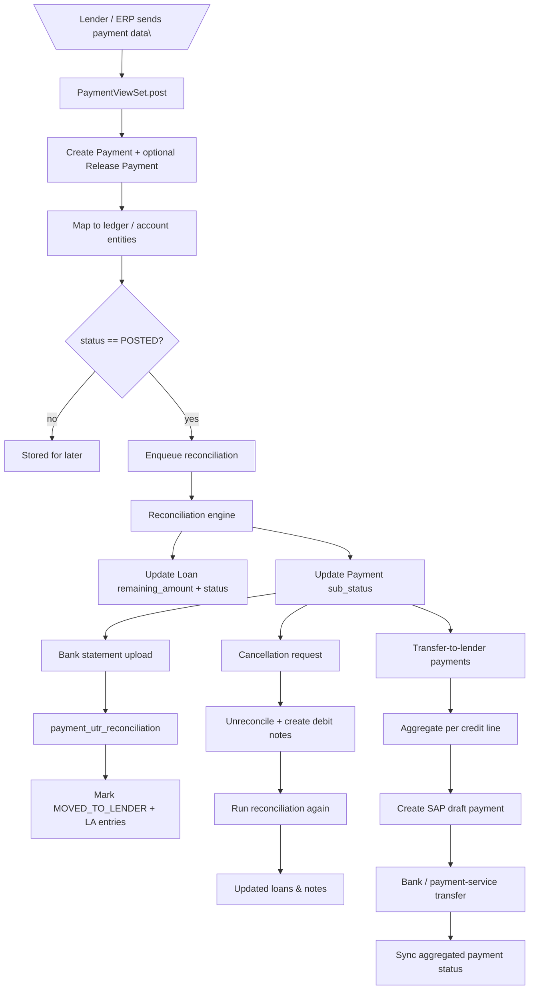

## Payment processing and reconciliation flow

**Goal**: Describe how payments are created, how they interact with loans and ledger entries, how reconciliation works (including cancellations), and how transfers to lenders / SAP integration are orchestrated.

You selected deep coverage, so this document covers both the main path and the key edge-case behaviours.

### Core models and constants

- `payment/model/payment.py::Payment`
  - Links to credit lines:
    - `customer_credit_line` – the credit line this payment applies to.
  - Lender identifiers:
    - `lender_payment_ref_number`, `lender_txn_number`, `lender_payment_id`.
  - Status:
    - `status = FSMField(choices=PaymentStatus.PAYMENT_STATUS_CHOICES, default=PaymentStatus.POSTED)`.
    - `sub_status` from `PaymentSubStatus`:
      - `UNRECONCILED`, `PARTIALLY_RECONCILED`, `RECONCILED`, `REFUNDED`, etc.
  - Amount fields:
    - `payment_amount`, `reconcilable_amount`, `transfer_to_lender_amount`,
      `payment_amount_settled`, `advance_amount`, `hold_amount`,
      `overdue_amount`, `aecl_amount`, `refund_amount`,
      `interest`, `penal_interest`, `overdue_interest`, `principal`, `processing_fee`.
  - Mode and metadata:
    - `payment_mode` (from `PaymentModes` – PG, CREDIT_NOTE, INVOICE_CANCELLED, etc.).
    - `gapl_payment_ref_number`, `payment_transfer_number`, `transfer_indicator`.
    - `la_entry_created`, `la_entry_status`, ERP-related fields.
  - Relationships:
    - `parent_payment_id` – used for derived/child payments (e.g. transfer-to-lender clones).
- `payment/constants.py`:
  - `PaymentStatus`, `PaymentSubStatus`, `PaymentModes` – core state enums.
  - `REPAYMENT_STATUS_MAP` / `PULL_REPAYMENT_STATUS_MAP` – mapping external repayment statuses to internal payment statuses.
  - `DebitNoteStatus`, `DebitNoteSubStatus` – statuses for debit notes.
  - `OutstandingEntityTypes`, `ReconciliationTriggerPoints` – used by reconciliation utilities.

### Key entry points

- **HTTP API**:
  - `payment/views.py::PaymentViewSet`:
    - `GET /payment/` – list and filter payments.
    - `POST /payment/` – create a new payment from lender/ERP payload.
- **Utilities**:
  - `payment/utils.py`:
    - `populate_payment` – prepares new `Payment` dict from validated data.
    - `update_payment` – handles partial updates and triggers tasks if reconciliation is running.
    - `payment_utr_reconciliation` – reconciles payments against a bank statement entry.
    - `create_transfer_to_lender_payment_from_payment` – clones a payment with status `TRANSFER_TO_LENDER`.
    - Cancellation/unreconciliation helpers:
      - `unrecon_payment_and_adjust_with_debit_entry`
      - `cancel_payment`
      - `cancel_credit_note`
      - `unreconcile_oustanding_entity`
      - `reconcile_cancelled_payment_with_created_debit_note`
- **Tasks**:
  - `payment/tasks.py`:
    - `create_payments` – bulk payment creation task.
    - `check_and_create_la_entries_in_sap` / `create_la_entry_in_sap` – create SAP LA entries.
    - Mixpanel-related and other integration tasks.

### Main payment creation flow

#### 1. Creating a payment from lender/ERP payload

`PaymentViewSet.post`:

1. Validates data:
   - `CreatePaymentRequestSerializer(data=data).is_valid(...)`
   - `transaction_raw_data = serializer.validated_data`
2. Resolves the customer credit line:
   - `customer_credit_line = fetch_cust_cl_by_source_n_product_name(partner_id, credit_line_name)`
3. Builds base payment dict:
   - `new_payment = populate_payment(customer_credit_line, transaction_raw_data)`
   - If `break_up` is present, populates:
     - `hold_amount`, `advance_amount`, `overdue_amount`, `aecl_amount`, `refund_amount`.
4. Idempotency check:
   - Looks for existing `Payment` with same `customer_credit_line`, `lender_payment_ref_number`, `lender_payment_id`.
   - If found, returns its id instead of creating a duplicate.
5. Release payment handling:
   - For `payment_type == "RELEASE_PAYMENT"` without reconciliation info:
     - Temporarily changes `payment_type` to `"PAYMENT"`.
     - Calls `populate_payment(..., _REL)` to derive a “release” payment.
     - Adds contextual comment for `ORDER_CANCELLED`, sets `refund_amount`, and saves a release `Payment`.
6. Creates the main payment:
   - Validates and saves `created_payment = PaymentSerializer(data=new_payment).save()`.

#### 2. Mapping payment to ledger or account entity

After payment creation:

- Uses `context_info` from payload:
  - If context is `PayByInvoiceConstants.LEDGER_ENTRIES` and the payment (or release payment) is `POSTED`:
    - Calls `map_payment_to_ledger_entries` to connect payment to ledger entries.
  - Else if the payment has `hold_amount` or is `RELEASED`:
    - Calls `create_account_entity_map` to represent hold/advance allocations.

#### 3. Triggering reconciliation

If the incoming payload has `status == "POSTED"`:

- Schedules reconciliation:
  - `run_reconciliation_for_customer_main.apply_async((partner_id, ReconciliationTriggerPoints.PAYMENT_CREATION))`
  - This reconciliation function:
    - Examines outstanding loans and previous reconciliation entries.
    - Distributes `reconcilable_amount` across loans.
    - Updates:
      - `Loan.remaining_amount`
      - Loan `status` (`PARTIALLY_PAID` / `PAID`, etc.).
      - `Payment.sub_status` (`UNRECONCILED` → `PARTIALLY_RECONCILED` / `RECONCILED`).
    - Creates reconciliation entries (e.g. `ReconciliationEntry`) tying loans and payments.

### Bank statement and transfer-to-lender flows

#### 4. Bank statement reconciliation (payment_utr_reconciliation)

`payment/utils.py::payment_utr_reconciliation(transfer_indicator, payment_transfer_number, transaction_amount)`:

1. Filters payments:
   - `Payment` records where:
     - `customer_credit_line.credit_product.belongs_to_gapl == True`,
     - `transfer_indicator` matches the bank statement’s indicator.
2. Verifies amount:
   - Aggregates `payment_amount` and compares to `transaction_amount`.
   - If mismatch, raises `ValidationError`.
3. Updates payments:
   - Sets `payment_transfer_number` for all matched payments.
4. Calls `post_moved_to_lender_action(payments, payment_transfer_number)` to:
   - Hide lender-payment ledger entry:
     - Fetches `LedgerEntry` of type `PAYMENT` and sets `visible = False`.
   - For each matched `Payment`:
     - If not already `MOVED_TO_LENDER`, updates `status = MOVED_TO_LENDER`.
     - Schedules `create_la_entry_in_sap(payment.id)` to create SAP LA entries.
   - Bulk-updates payment statuses.
   - Schedules `update_credit_lines_status` for each partner to reflect new status.

#### 5. Creating transfer-to-lender payments

`create_transfer_to_lender_payment_from_payment(payment, transfer_to_lender_amount)`:

- Clones the original payment:
  - Resets `id`, sets:
    - `status = PaymentStatus.TRANSFER_TO_LENDER`
    - `sub_status = PaymentSubStatus.UNRECONCILED`
    - `payment_amount = transfer_to_lender_amount`
    - `reconcilable_amount = 0`, `transfer_to_lender_amount = 0`
    - `hold_amount = 0`
    - `parent_payment_id = payment.id`
- Saves and returns the new transfer-to-lender payment.

This is typically used when reconciled GAPL payments are moved to lender-specific entries.

#### 6. Aggregated payment transfers to lenders

In addition to per-payment transfers, Locus can **aggregate multiple transfer-to-lender payments** into a single aggregated transfer per customer credit line.

Key pieces:

- Statuses and entities:
  - `PaymentStatus.TRANSFER_TO_LENDER` – status of child payments created via `create_transfer_to_lender_payment_from_payment`.
  - `PaymentStatus.TRANSFER_INITIATED` – status of payments once they are attached to an aggregated transfer.
  - `AggregatedPaymentTransfer` – model representing a single aggregated transfer request (customer, amount, lender, SAP metadata, etc.).
  - `PaymentTransferStatus` – state of an aggregated transfer:
    - `YET_TO_TRANSFER`, `PENDING_APPROVAL`, `STARTED`, `INITIATED`, `TRANSFERRED`, `FAILED`, `ERROR`, `REJECTED`, `REFUNDED`, `REVERSED`.

High-level pipeline:

1. **Create transfer-to-lender payments** (per invoice/loan):
   - As described above, `create_transfer_to_lender_payment_from_payment` clones a base `Payment` and sets:
     - `status = TRANSFER_TO_LENDER`
     - `sub_status = UNRECONCILED`
   - These payments represent individual lender transfers but are not yet sent to the bank/SAP.

2. **Aggregate payments per customer credit line**:
   - Task: `payment.tasks.aggregate_payment_transfer` (see `scheduled_tasks.md`).
   - It:
     - Filters payments in `TRANSFER_TO_LENDER` status for the configured credit product(s), e.g. `DEHAAT_CL`.
     - Optionally restricts by allowed partner IDs using app constants.
     - For each `customer_credit_line_id`, it enqueues:
       - `aggregate_ccl_payment_transfer(customer_credit_line_id)`.
   - `aggregate_ccl_payment_transfer`:
     - Validates reconciliation consistency for the credit line (or skips for whitelisted partners).
     - Computes the total `amount` by summing `payment_amount` for all `TRANSFER_TO_LENDER` payments on that line.
     - Ensures the amount is at least 1 rupee.
     - Creates an `AggregatedPaymentTransfer` object with:
       - `customer`, `amount`, `request_id`, `payment_ref_num`, and `transfer_to` (lender).
     - For each underlying payment:
       - Creates a mapping (`AggregatedPaymentTransferMap`) linking payment → aggregated transfer.
       - Updates payment `status = TRANSFER_INITIATED`.

3. **Triggering bank/SAP transfer for aggregated payments**:
   - Task: `payment.tasks.transfer_all_agg_payments` (see `scheduled_tasks.md`).
   - It:
     - First sends a summary mail for `PENDING_APPROVAL` aggregated payments.
     - Selects aggregated payments whose status is `YET_TO_TRANSFER` or `ERROR`, with try-count below a maximum.
     - Enqueues `transfer_agg_payment(agg_payment.id)` for each.
   - `transfer_agg_payment`:
     - Applies a Redis lock per aggregated payment to avoid concurrent processing.
     - Skips if status is already in a terminal or in-progress state.
     - Ensures the transfer try-count has not exceeded the configured maximum.
     - Sets `status = STARTED`, increments `transfer_try_count`.
     - Calls:
       - `create_transfer_to_lender_payment_in_draft_mode(agg_payment)`:
         - Builds an SAP payload via `prep_data_for_bank_to_lender_sap_draft_payment`.
         - Posts a **draft** payment to SAP and updates `erp_upload_status`, storing the SAP document number.
       - Prepares and sends the final transfer payload to the payment service (`transfer_payment`).
     - On success:
       - Marks the aggregated payment as `INITIATED` and stores a unique transaction reference from the payment service.
     - On error:
       - Sets `status = ERROR`, `failure_reason`, and `erp_upload_status = DRAFT_UPLOAD_FAILED`.
       - Sends a failure email via `send_payment_transfer_failed_email`.

4. **Syncing aggregated transfer status back from payment service**:
   - Task: `payment.tasks.sync_all_aggregated_payments`.
   - It:
     - Selects aggregated payments that are `INITIATED` for at least a configured time, or in `ERROR`/`FAILED` state.
     - For each, enqueues `sync_aggregated_payment(agg_payment.id)`.
   - `sync_aggregated_payment`:
     - Calls `PaymentService().fetch_payment(agg_payment.request_id)` to retrieve the latest status.
     - Calls `process_payment_service_webhook(resp[0])` to update Locus state (payments, aggregated payment status) from the webhook-like payload.

5. **Reversing aggregated payments**:
   - Task: `payment.tasks.reverse_aggregated_payments`.
   - It:
     - Finds aggregated payments that have:
       - Stayed in `ERROR`/`FAILED` beyond a configurable number of days, or
       - Stayed in `REJECTED` status beyond a configurable number of days, or
       - Are in `REFUNDED` status.
     - Groups underlying payments per partner and enqueues:
       - `reverse_transfer_to_lender_partner_payments(partner_id, payment_ids)`.
   - `reverse_transfer_to_lender_partner_payments`:
     - Calls `reverse_transfer_to_lender_payments_for_partner` to:
       - Reverse the movement to lender for the specified payments.
       - Update payment statuses and reconciliation state.
     - Marks relevant `AggregatedPaymentTransfer` records and maps as inactive where appropriate.

Together, this pipeline ensures that **multiple transfer-to-lender payments are combined into a single bank/SAP transfer per customer**, while providing retries, status sync, and reversal in error scenarios.

### Cancellation and unreconciliation flows

#### 6. Payment cancellation (`cancel_payment`)

`payment/utils.py::cancel_payment(partner_id, lender_payment_ref_number, lender_payment_id, cancellation_soure="SAP")`:

1. Fetches GAPL payments matching partner and lender identifiers.
2. If none found, returns `{id: None}`.
3. Finds origin payment as the one with `parent_payment_id is null`.
4. If origin payment already cancelled in SAP or status `CANCELLED`, returns with its id.
5. If origin sub_status is `UNRECONCILED`:
   - Sets `status = CANCELLED`, `cancelled_in_sap = True`.
   - Saves and sends Mixpanel cancellation event.
6. Otherwise:
   - Calls `unrecon_payment_and_adjust_with_debit_entry(partner_id, origin_payment)`:
     - Uses `perform_unreconciliation_during_cancellation` to:
       - Walk through reconciliation entries.
       - Reopen outstanding entities (loans, debit notes, etc.).
       - Adjust `Loan.remaining_amount` and statuses appropriately (often via `unreconcile_oustanding_entity`).
     - Creates debit notes to capture cancellation adjustments.
   - Runs `run_reconciliation_for_customer_main(partner_id, ReconciliationTriggerPoints.CANCELLATION_FLOW)` to re-balance.
   - Marks all related payments `cancelled_in_sap = True`.
   - Emits cancellation event.

#### 7. Credit note cancellation (`cancel_credit_note`)

`payment/utils.py::cancel_credit_note(partner_id, erp_id, cancellation_soure="SAP")`:

1. Fetches `CreditNote` by internal id.
2. If not found, returns `{id: None}`.
3. If already cancelled, returns its id.
4. Gets `cn_payments` linked to this credit note.
5. If credit note is “instant discount”:
   - Simply marks all `cn_payments.cancelled_in_sap = True`.
6. Else:
   - Creates a debit note to offset the credit note:
     - `create_debit_note_for_cancelled_credit_note(credit_note, reason=CANCELLED_PAYMENT)`.
   - Calls `adjust_cn_payments_with_created_dn(partner_id, cn_payments, created_debit_note)`:
     - If any payment is reconciled, it first unreconciles it.
     - Then uses `reconcile_cancelled_payment_with_created_debit_note` to match debit note and payment, updating:
       - Debit note `reconcilable_amount` and sub_status.
       - Payment `reconcilable_amount` and sub_status.
7. Re-runs reconciliation and marks everything appropriately:
   - `run_reconciliation_for_customer_main(partner_id, ReconciliationTriggerPoints.CANCELLATION_FLOW)`.
   - `credit_note.cancelled_in_sap = True`.
   - Schedules Mixpanel events.

#### 8. Unreconciling outstanding entities

`payment/utils.py::unreconcile_oustanding_entity(entry_to_unreconcile)`:

- For `OutstandingEntityTypes.GAPL_LOAN`:
  - Loads the target `Loan`.
  - Increases `remaining_amount` by `payment_amount_used`.
  - Sets loan status:
    - If `remaining_amount < loan_amount` → `PARTIALLY_PAID`.
    - If `remaining_amount == loan_amount` → `DISBURSED`.
    - Else: raises error (invalid state).
- Similar logic applies for other outstanding entity types (debit notes, etc.), but the key impact for loans is to revert them from `PAID`/partially reconciled states when payments are cancelled or adjusted.

### Mermaid diagram (high-level)

### Where to read next

- For how loans are created and how loan statuses interact with payments, see `loan_lifecycle.md`.
- For the lead onboarding that eventually generates loans and payments, see `lead_processing.md`.

