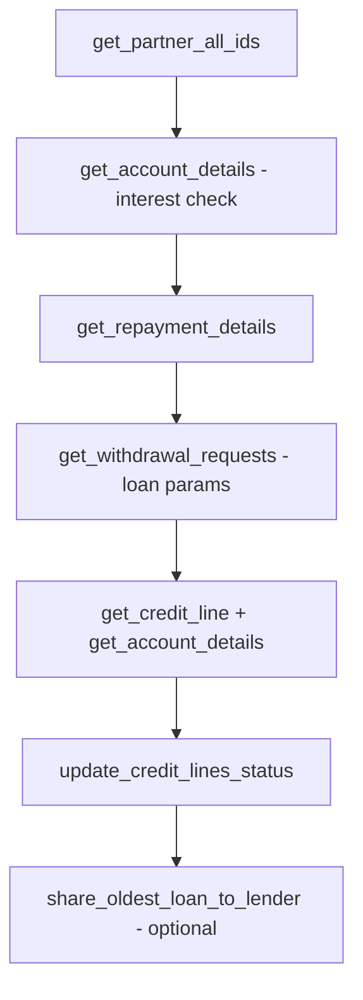
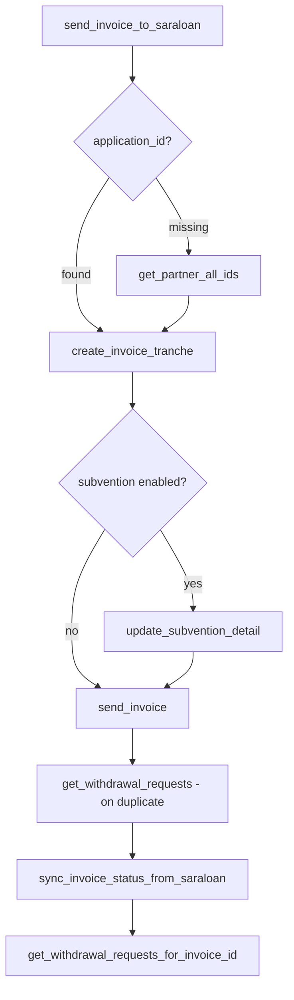
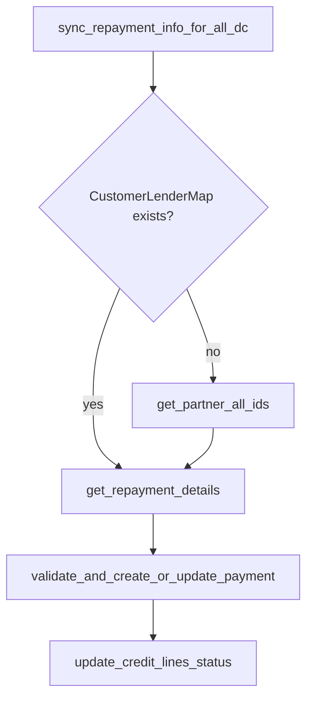

## Saraloan API flows

**Goal**: Document the four major Locus ↔ Saraloan integration flows — onboarding, partner data sync, disbursement, and repayment — with every Saraloan API called in each flow.

**Client**: `common/external/saraloan/saraloan.py::Saraloan`  
**Base URL**: `settings.SARALOAN["BASE_URL"]` (typically `https://<env>.saraloan.in/api/v1`)  
**Credentials**: `SaraloanCredConstants.DC` (DeHaat Center) or `SaraloanCredConstants.FARMER`

---

## Quick reference — APIs by flow

| Flow | Saraloan APIs used |
|------|-------------------|
| **Onboarding** | DC + farmer Core/LOS/e-sign only — **no** `loan_account_id` in requests. See §1 and `.cursor/saraloan-onboarding-flow.md` |
| **Partner sync** | `get_partner_all_ids`, `get_repayment_details`, `get_withdrawal_requests`, `get_account_details`, `get_credit_line`, `get_loan_agreement`, `refresh_loan_account`, `get_application_details`, `get_business_details` |
| **Disbursement** | `get_partner_all_ids`, `create_invoice_tranche`, `update_subvention_detail`, `send_invoice`, `get_withdrawal_requests`, `get_withdrawal_requests_for_invoice_id`, `delete_invoice` |
| **Repayment** | `get_repayment_details`, `get_repayments`, `get_account_details`, `get_application_details` |

---

## 1. Onboarding flow

**Scope:** DC (ME-Blacksoil) and farmer (Farmer-Blacksoil). All onboarding traffic is **v1 Core + LOS + e-sign**.  
**Narrative / ops:** `.cursor/saraloan-onboarding-flow.md`  
**Lead intake:** `.cursor/lead_processing.md`

### Entry points

| Type | Location | Trigger |
|------|----------|---------|
| Celery | `lead.tasks.send_lead_to_saraloan` | Scheduled — `LeadLenderMap` `YET_TO_PROCESS` / `ERROR` |
| Celery | `lead.tasks.saraloan_start_onboarding_process` → KYC chain | Per DC lead |
| Celery | `lead.tasks.sync_saraloan_leads_status` | Post–data-push LOS status |
| Celery | `lead.tasks.sync_pdc_to_saraloan` | PDC retry |
| HTTP | `GetSaraloanLeadEsignUrl`, `GetNachDetails`, `ActivateCustomer` | `lead/views.py` |
| Celery / FF | `farmer_financing/tasks.py`, `farmer_financing/saraloan.py` | Farmer KYC, `send_to_los`, credit-line steps, e-sign |

### Identifier usage (onboarding only)

| ID | Used as HTTP/path input? | Count (approx., unique methods) |
|----|--------------------------|----------------------------------|
| **loan_account_id** | **No** | **0** — LMS loan account APIs are **not** called during onboarding |
| **application_id** | Yes | ~12–14 (PDC, LOS status, e-sign, farmer approve/initiate/activate credit line) |
| **business_id** | Yes | ~15–18 (Core KYC, NACH, partner patch, farmer LOS / credit line) |
| **person_id** | Yes | ~6 (person KYC) |
| **mobile / partner_id** | Yes | 2 (`get_auth_details`, `get_partner_all_ids`) |

`loan_account_id` is returned by **`get_partner_all_ids`** during status sync / recovery and stored later on **`CustomerLenderMap`** via partner sync—not used as a request key in the KYC chain.

### DC — KYC chain (`lead/tasks.py`)

| Locus task | Saraloan method | Primary ID |
|------------|-----------------|------------|
| `saraloan_create_business` | `create_business` | — (returns business_id, person_id) |
| `saraloan_get_business_details` | `get_business_details` | **business_id** (`expand=extra`) |
| `saraloan_create_*_business_document` | `create_business_documents` | **business_id** |
| `saraloan_create_business_address` | `create_business_address` | **business_id** |
| `saraloan_create_bank` | `create_bank` | **business_id** |
| `saraloan_update_personal_details` | `update_personal_details` | **person_id** |
| `saraloan_get_person_documents` | `get_person_documents` | **person_id** |
| `saraloan_*_person_document` | `update_person_documents` | **person_id** |
| `saraloan_create_person_address` | `create_person_address` | **person_id** |

`send_to_los` (**business_id**) is **commented out** for DC; farmer onboarding **does** call `send_to_los`.

### DC — PDC, status, e-sign, NACH, activation

| Caller | Saraloan method | Primary ID |
|--------|-----------------|------------|
| `send_pdc_to_saraloan` | `get_bank_id` | **business_id** |
| `send_pdc_to_saraloan` | `create_pdc_documents`, `update_pdc_documents` | **application_id** |
| `sync_each_saraloan_lead_status` | `get_business_details` | **business_id** |
| `sync_each_saraloan_lead_status` | `get_application_details` | **application_id** |
| `fetch_saraloan_map_with_mobile` | `get_partner_all_ids` | **mobile** (returns all ids) |
| `lead/utils.py` e-sign helpers | `get_application_document`, `get_attached_stamp_paper`, `create_or_initiate_esign`, `get_application_esign`, `get_updated_esign_data` | **application_id** / esign id |
| `GetNachDetails` | `get_bank_id`, `nach_status_refresh`, `get_nach_status`, `create_emandate_registration_link` | **business_id**, bank_id |
| `ActivateCustomer` / `saraloan_update_partner_id` | `update_partner_id` | **business_id** |

### Farmer-only onboarding APIs (`farmer_financing/`, `FARMER` creds)

| Saraloan method | Primary ID |
|-----------------|------------|
| `get_auth_details` | **mobile** |
| `send_to_los` | **business_id** |
| `get_linked_person_details` | **application_id** |
| `update_business_details`, `update_credit_line` | **business_id** |
| `get_approve_credit_line`, `get_initiate_credit_line`, `get_activate_credit_line` | **application_id** |
| `link_signers_to_business` | **business_id** |
| `update_person_email`, `update_personal_details_dob`, `create_person_document` | **person_id** |
| `get_application_form`, `create_document_esign` | **application_id** / **business_id** |

Shared with DC: `create_business`, `get_business_details`, addresses, banks, person docs (see DC table).

### Not onboarding — business loan expand (LOC-63)

Post-onboarding sync uses **`get_business_loan_accounts`** → `get_business_details` with:

`loan_account.extra,loan_account.topups.extra,loan_account.topups.invoice`

(Saraloan expects **`loan_account`** singular; **`loan_accounts`** expand returns 500.)  
Defined in `common/external/saraloan/utils.py` — **not** used in the DC KYC chain.

---

## 2. Sync Saraloan partner data

**Scope**: Keep `CustomerLenderMap`, `CustomerCreditLine`, loans, repayments, and virtual accounts in sync with Saraloan for financed DC and farmer customers.

### Entry points

| Type | Location | Trigger |
|------|----------|---------|
| Celery (umbrella) | `payment.tasks.sync_partners_saraloan_data` | Manual admin, API, or downstream retry |
| Celery (batch) | `credit_line.tasks.sync_customers_from_saraloan` | Scheduled — all ME-Blacksoil / Farmer-Blacksoil customers |
| Celery | `credit_line.tasks.sync_credit_lines_info_from_saraloan` | Scheduled |
| Celery | `credit_line.tasks.sync_loans_params_from_saraloan` | Scheduled |
| Celery | `payment.tasks.sync_repayment_info_for_all_dc` | Scheduled |
| Celery | `loan.tasks.sync_loan_account_processed_data_from_saraloan` | Scheduled — catches missed `loan_account_processed` webhooks |
| Celery | `virtual_account.tasks.sync_virtual_account_details_from_saraloan` | Scheduled / chained from credit line sync |
| Celery | `repayment.tasks.fetch_virtual_account_details_saraloan` | Scheduled (alternate VA path) |

### Umbrella sync — `sync_partners_saraloan_data`

Orchestrates a full partner refresh in this order:

| Step | Locus function | Saraloan method | HTTP | Endpoint | Writes to |
|------|---------------|-----------------|------|----------|-----------|
| 1 | `sync_partner_ids_from_saraloan` | `get_partner_all_ids` | GET | `/core/business_query/?partner_lead_id={id}&mobile={mobile}` | `CustomerLenderMap` (`business_id`, `application_id`, `loan_account_id`) |
| 2 | `fetch_account_detail_and_validate_interest_component` | `get_account_details` | GET | `/lms/loan_accounts/{loan_account_id}/?expand=extra,topups.invoice,topups.extra` | Interest validation only |
| 3 | `fetch_and_update_repayments_info` | `get_repayment_details` | GET | `/lms/loan_accounts/{loan_account_id}/repayments/` (paginated) | `Payment` records |
| 4 | `fetch_and_update_loans_params` | `get_withdrawal_requests` | GET | `/los/applications/{application_id}/invoices/?expand=topup.extra,topup.loan_data,files` (paginated) | `Loan`, `LenderLoanMap` disbursement fields |
| 5 | `fetch_and_update_credit_line_info` | `get_credit_line` | GET | `/core/businesses/{business_id}/credit_line/` | `CustomerCreditLine` limits, outstanding, status |
| 5b | `fetch_and_update_credit_line_info` | `get_account_details` | GET | `/lms/loan_accounts/{loan_account_id}/?expand=extra,topups.invoice,topups.extra` | Outstanding, advance, interest components |
| 5c | `fetch_and_update_credit_line_info` | `get_loan_agreement` | GET | `/los/applications/{application_id}/documents?doc_name=loan_agreement` | Limit enhancement detection |
| 6 | `refresh_saraloan_loan_account` | `refresh_loan_account` | GET | `/lms/loan_accounts/{loan_account_id}/recalculate_accounting/` | Triggers Saraloan recalc when interest discrepancy flagged |

### Virtual account sync

Two paths exist:

**Path A** — `virtual_account.tasks.fetch_and_update_customer_virtual_account_info` (chained from credit line sync):

| Saraloan method | HTTP | Endpoint |
|-----------------|------|----------|
| `get_application_details` | GET | `/los/applications/{application_id}/?expand=extra` |

Reads `extra.icici_va` or `extra.razorpay_account_details` → `CustomerVirtualAccount`.

**Path B** — `repayment.tasks.update_virtual_account_details`:

| Saraloan method | HTTP | Endpoint |
|-----------------|------|----------|
| `get_account_details` | GET | `/lms/loan_accounts/{loan_account_id}/?expand=topups.application.extra` |

Reads VA from first topup's application extra.

### Loan account closure check

`loan/tasks.py` (dormancy / closure logic):

| Saraloan method | HTTP | Endpoint |
|-----------------|------|----------|
| `get_business_details` | GET | `/core/businesses/{business_id}/?expand=credit_line` |

Checks `credit_line.loan_closure_letter_file` to determine if loan account is closed.

### Scheduled tasks summary

| Task | Primary Saraloan APIs |
|------|----------------------|
| `sync_customers_from_saraloan` | `get_partner_all_ids` |
| `sync_credit_lines_info_from_saraloan` | `get_partner_all_ids`, `get_credit_line`, `get_account_details`, `get_loan_agreement` |
| `sync_loans_params_from_saraloan` | `get_partner_all_ids`, `get_withdrawal_requests` |
| `sync_repayment_info_for_all_dc` | `get_partner_all_ids`, `get_repayment_details` |
| `sync_loan_account_processed_data_from_saraloan` | Delegates to `sync_partners_saraloan_data` (all APIs above) |

---

## 3. Disbursement flow

**Scope**: Share a Locus loan/invoice to Saraloan (Blacksoil) for lender financing — create tranche, optionally set subvention, upload invoice PDF, and sync disbursement status back.

**Docs**: See also `loan_lifecycle.md`, `lender_invoice_share_flow_slinv_churn.md`.

### Entry points

| Type | Location | Trigger |
|------|----------|---------|
| Celery | `loan.tasks.share_oldest_loan_to_lender` | Move-to-lender event, or chained from `sync_partners_saraloan_data` |
| Celery | `loan.tasks.send_invoice_to_saraloan` | Per `LenderLoanMap` |
| Celery | `loan.tasks.create_tranche_in_blacksoil` | After application ID resolved |
| Celery | `loan.tasks.update_subvention_details_in_saraloan` | DC customers with subvention enabled |
| Celery | `loan.tasks.create_invoice_in_blacksoil` | Upload invoice PDF |
| Celery | `loan.tasks.sync_invoice_status_from_saraloan` | Scheduled — sync lender invoice status |
| Celery / utility | `loan/utility.py::handle_saraloan_invoice_deletion` | Invoice cancellation at lender |

### Flow

| Step | Locus task / function | Saraloan method | HTTP | Endpoint | Purpose |
|------|----------------------|-----------------|------|----------|---------|
| 0 | `send_invoice_to_saraloan` | `get_partner_all_ids` | GET | `/core/business_query/?partner_lead_id={id}` | Resolve `application_id` if `CustomerLenderMap` missing |
| 1 | `create_tranche_in_blacksoil` | `create_invoice_tranche` | POST | `/los/applications/{application_id}/invoices/` | Create withdrawal/tranche (returns `lender_invoice_transaction_id`, `lender_invoice_id`) |
| 2 | `update_subvention_details_in_saraloan` | `update_subvention_detail` | PATCH | `{update_subvention_url}` (from `LenderLoanMap`) | Set subvention days before invoice upload |
| 3 | `create_invoice_in_blacksoil` | `send_invoice` | POST | `/los/applications/{application_id}/invoices/{invoice_id}/files/` | Upload invoice PDF + amounts (multipart) |
| 3b | `create_invoice_in_blacksoil` (duplicate recovery) | `get_withdrawal_requests` | GET | `/los/applications/{application_id}/invoices/?expand=topup.extra,topup.loan_data,files` | Match existing invoice by `invoice_number` when Saraloan returns "already exists" |
| 4 | `sync_invoice_status_from_saraloan` | `get_withdrawal_requests_for_invoice_id` | GET | `/los/applications/{application_id}/invoices/{invoice_id}/?expand=files` | Read status: Pending / Approved / Rejected / Disbursed |
| 5 | `handle_saraloan_invoice_deletion` | `get_withdrawal_requests_for_invoice_id` | GET | Same as above | Check status before deletion |
| 5b | `handle_saraloan_invoice_deletion` | `delete_invoice` | DELETE | `/los/applications/{application_id}/invoices/{invoice_id}/files/{file_id}/` | Cancel pending/rejected invoice at lender |

### Disbursement status ingestion

When partner sync runs (`fetch_and_update_loans_params`), the same `get_withdrawal_requests` response drives loan status updates in Locus:

- `disbursement_date`, `disbursed_amount`, `source_subvented_amount`
- Invoice status at lender (Approved / Disbursed)
- Triggers `send_disbursement_notification` and ERP posting tasks (no additional Saraloan API)

### V2 endpoints (config only)

`config/settings/base.py` defines v2 equivalents not yet used by the client:

- `post_tranche_create_api_v2`: `/core/businesses/{business_id}/invoices/`
- `get_withdrawal_list_v2`: `/core/businesses/{business_id}/invoices/`
- `get_withdrawal_v2`: `/core/businesses/{business_id}/invoices/{invoice_id}/`

---

## 4. Repayment flow

**Scope**: Ingest repayments from Saraloan into Locus `Payment` records, reconcile against loans, and refresh credit line / loan state.

**Docs**: See also `payment_processing.md`, `repayment-workflow.md`.

### Entry points

| Type | Location | Trigger |
|------|----------|---------|
| Webhook | `payment.tasks.process_saraloan_repayment_webhook` | Saraloan push: `repayment_captured`, `repayment_credited`, `repayment_bounced` |
| Celery (batch) | `payment.tasks.sync_repayment_info_for_all_dc` | Scheduled pull for all financed customers |
| Celery (umbrella) | `payment.tasks.sync_partners_saraloan_data` | Full partner sync includes repayments |
| Celery | `payment.tasks.fetch_and_update_repayments_info` | Per-customer repayment pull |
| Utility | `payment.utils` (reconciliation helper) | Post-payment loan reconciliation |
| HTTP | `payment/views.py` (outstanding breakup) | On-demand `get_account_details` for payment allocation UI |

### Pull flow (scheduled / manual sync)

| Step | Locus function | Saraloan method | HTTP | Endpoint | Purpose |
|------|---------------|-----------------|------|----------|---------|
| 0 | `sync_repayment_info_for_all_dc` | `get_partner_all_ids` | GET | `/core/business_query/?partner_lead_id={id}` | Resolve `loan_account_id` if missing |
| 1 | `fetch_and_update_repayments_info` | `get_repayment_details` | GET | `/lms/loan_accounts/{loan_account_id}/repayments/` | Paginated list of all repayments |
| 2 | (post-sync) | — | — | — | `update_credit_lines_status` — no Saraloan call |

**Fields ingested per repayment**: `payment_amount`, `principal`, `interest`, `penal_interest`, `overdue_interest`, `payment_date`, `settlement_date`, `status` (`credited` / `bounced`), `lender_payment_id` (`txn_id`).

### Webhook flow (push)

`process_saraloan_repayment_webhook` → `process_repayment_data`:

| Event | Follow-up Saraloan APIs |
|-------|------------------------|
| `repayment_captured` | `get_account_details` (interest check), then async `get_withdrawal_requests` + `get_credit_line` + `get_account_details` |
| `repayment_credited` / `repayment_bounced` | Same as above (with 5-min delay via Celery) |

On successful webhook processing:

1. `validate_and_create_or_update_payment` — creates/updates `Payment`
2. `sync_credit_line_loans_params_from_saraloan` → `get_withdrawal_requests`
3. `sync_credit_line_info_from_saraloan` → `get_credit_line`, `get_account_details`
4. `update_credit_lines_status` — internal only

### Reconciliation — settlement ledger lookup

When reconciling a payment against specific loans (`payment/utils.py`):

| Saraloan method | HTTP | Endpoint | Purpose |
|-----------------|------|----------|---------|
| `get_repayments` | GET | `/lms/loan_accounts/{loan_account_id}/repayments/?expand=bank_payment,settlement_ledgers` | Match repayment by `txn_id`, read `settlement_ledgers` to find `SLINV` topup IDs |

Maps `SLINV` IDs → `LenderLoanMap.lender_invoice_id` → loan-level reconciliation.

### On-demand outstanding (payment UI)

`payment/views.py` payment breakup endpoint:

| Saraloan method | HTTP | Endpoint |
|-----------------|------|----------|
| `get_account_details` | GET | `/lms/loan_accounts/{loan_account_id}/?expand=extra` |

Reads `extra.total_outstanding` for lender outstanding display.

### Transfer-to-lender (GAPL → lender)

After a GAPL payment is reconciled and moved to lender, Locus creates a child `TRANSFER_TO_LENDER` payment. The actual fund transfer is posted to SAP/ERP — **no additional Saraloan API** is called for the transfer itself. Saraloan reflects the repayment via the normal pull/webhook paths above.

### Virtual account for repayments

Customers repay via VA/UPI details synced from Saraloan (see §2 Virtual account sync). No separate Saraloan API is called at repayment collection time in Locus.

---

## Saraloan APIs defined but not used in these four flows

These exist in `saraloan.py` / `config/settings/base.py` but are used elsewhere or are legacy:

| Method | Endpoint | Used in |
|--------|----------|---------|
| `get_partner_payments` | `/lms/loan_accounts/{id}/repayments/?page={page}` | Legacy — prefer `get_repayment_details` |
| `get_payment_detail` | `/lms/loan_accounts/{id}/repayments/{repayment_id}` | Not actively called |
| `get_ledger_details` | `/lms/loan_accounts/{id}/ledgers/?repayment_id={id}` | Config only |
| `update_credit_line` | `/core/businesses/{id}/credit_line/{cl_id}/` | Not in main flows |
| `get_approve/initiate/activate_credit_line` | `/los/applications/{id}/...` | Farmer onboarding / UW (§1) |
| `get_auth_details` | `/core/businesses/get_embed_session/` | Farmer onboarding lookup (§1) |
| `get_business_loan_accounts` | `/core/businesses/{id}/?expand=loan_account...` | Partner sync / LOC-63 (not onboarding) |
| `get_credit_line_v2`, `get_withdrawal_requests_v2`, `get_repayments_v2` | v2 business paths | Partner sync when gRPC off (LOC-63) |
| `create_auto_pay_mandate` | `/core/businesses/{id}/banks/{bank_id}/create_upi_mandate_form/` | `auto_pay/tasks.py` |
| `get_document_text` | `/core/businesses/{id}/common_data/` | Ad-hoc |
| `update_business` / `link_signers_to_business` | `/core/businesses/{id}/` | Farmer co-borrower / guarantor (§1) |

---

## Credential and customer-type matrix

| Customer type | Credential | Onboarding | Sync | Disbursement | Repayment |
|--------------|------------|------------|------|--------------|-----------|
| DC (financed) | `SaraloanCredConstants.DC` | Yes | Yes | Yes | Yes |
| DC (GAPL-only) | — | Yes (lead only) | No | No | No |
| Farmer | `SaraloanCredConstants.FARMER` | `farmer_financing/` | Yes | Yes | Yes |

---

## Related files

| Area | Key files |
|------|-----------|
| Saraloan client | `common/external/saraloan/saraloan.py`, `common/external/saraloan/utils.py` |
| API config | `config/settings/base.py` → `SARALOAN["ENDPOINTS"]` |
| Payload reference | `scripts/saraloan_locus_client_payloads.json` |
| Onboarding | `lead/tasks.py`, `lead/utils.py`, `lead/views.py` |
| Partner sync | `credit_line/tasks.py`, `payment/tasks.py`, `virtual_account/tasks.py` |
| Disbursement | `loan/tasks.py`, `loan/utility.py` |
| Repayment | `payment/tasks.py`, `payment/utils.py`, `repayment/tasks.py` |
| Scheduled tasks | `.cursor/scheduled_tasks.md` |
